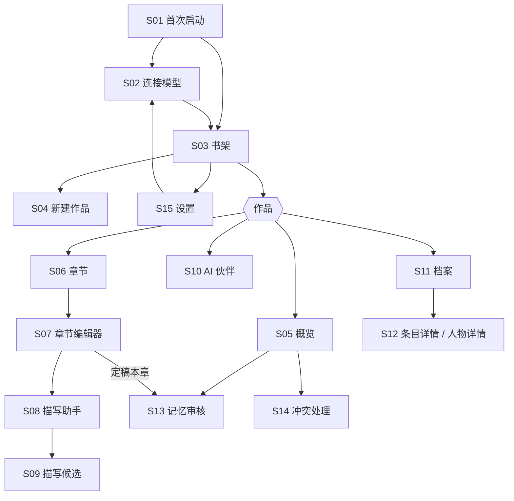
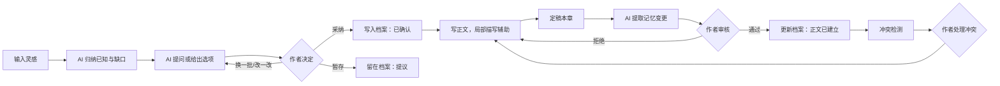
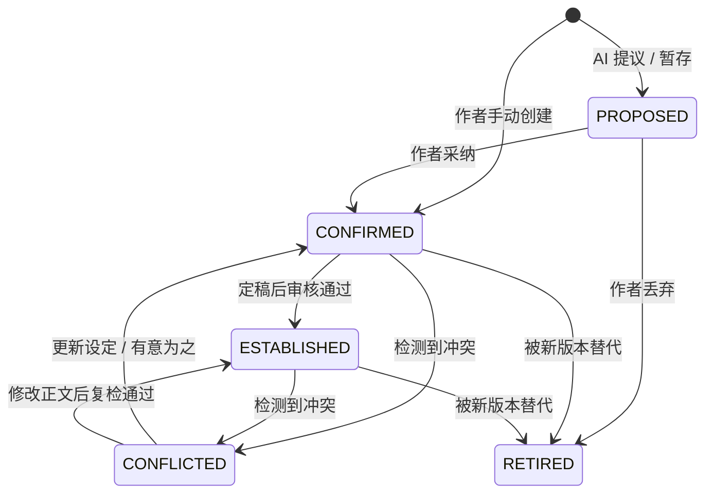

# AI 小说创作伙伴 · 产品设计文档

| 项目 | 内容 |
| --- | --- |
| 版本 | V1.1（设计稿，待评审） |
| 日期 | 2026-10-16 |
| 依据 | [产品说明文档 V1.0](PRODUCT_BRIEF.md)、第一版界面草图（11 屏） |
| 配套 | [UI 设计规范](UI_DESIGN.md)、[交互原型](design/prototype.html)（浏览器直接打开） |
| 适用 | Android / iOS（React Native），V1 本地优先 |

本文把产品说明里的方向落实到页面、交互和规则，供设计、开发和测试共同使用。页面编号 S01–S15 与交互原型一一对应。

## 1. 本次修订摘要

第一版草图确立了整体风格和主要页面，本版保留其紫色品牌、浅色界面和页面划分，主要修改以下几处：

| 第一版草图 | 本版修订 | 原因 |
| --- | --- | --- |
| 启动页有"登录"按钮；"个人中心"显示头像和"普通用户" | 去掉账号体系。首次启动只有引导和"连接模型"（可跳过）；"个人中心"改为"设置" | V1 不设服务器，作品和 Key 都只存在手机上 |
| 只在个人中心列了"模型配置"入口 | 新增模型服务页：选择协议（OpenAI Responses / Anthropic Messages），填写 Base URL、API Key、模型，支持连接测试 | 用户自带模型服务和 Key |
| 作品概览页同时有顶部标签（概览/设定/人物/世界观/剧情线）和全局底部栏（首页/项目/创作/我的） | 书架是根页面；进入作品后用一组底部标签：概览、章节、AI 伙伴、档案 | 两层导航重叠，用户分不清当前在哪一层 |
| "新建章节"页带写作要求和"开始生成"，像是生成整章 | 新建章节只负责建章；AI 生成只在编辑器里针对选区或光标处做局部描写 | 符合简报"以局部描写辅助为主，不接管整部小说" |
| 编辑器右下角"下一步" | 改为"定稿本章"，并说明定稿后会提取记忆变更 | 按钮应说明它会做什么 |
| AI 选项卡只有"换一批""对比方案" | 每个选项可"采纳为设定""暂存""改一改再采纳" | 简报 4.1：未确认的内容不得写入正式设定 |
| 记忆审核只有"通过/拒绝" | 增加变更前后对比、正文出处、"修改后通过"和批量通过 | 简报 4.7、5.3 |
| 冲突检测只给一段建议文字 | 两处出处并排显示；提供四种处理：改正文、改设定、标记为有意为之、稍后处理 | 小说里的"矛盾"可能是伏笔或不可靠叙述，不能一律当错误 |
| 作品封面使用插画 | 默认生成文字书封（竖排书名 + 题材色），可换成相册图片 | V1 只接入文本模型，不生成图片 |
| 创作流程示意（8 步） | 保留，作为本文第 4 节的流程图 | — |

## 2. 关键决策

### 2.1 本地优先

V1 没有账号、没有业务服务器。作品、章节、档案、版本和审核记录存在手机本地 SQLite；API Key 存在系统安全存储（iOS Keychain、Android Keystore）。App 直接请求用户填写的模型服务地址。

这样做的好处是上线快、用户数据不经过我们、不需要承担服务器和 Key 托管的成本与风险。代价是暂不支持多设备同步，换机靠导出/导入备份。云同步和后端编排（Java + LangGraph，见[架构文档](../ARCHITECTURE.md)）放到后续版本，且应可选。

### 2.2 自带模型服务，只支持两种协议

用户可以添加多个"模型服务"，每个服务选择一种协议：

| 协议 | 端点 | 适用 |
| --- | --- | --- |
| OpenAI Responses API | `POST {base}/responses` | OpenAI 官方，以及兼容 Responses API 的中转服务 |
| Anthropic Messages API | `POST {base}/v1/messages` | Anthropic 官方，以及兼容 Messages API 的中转服务 |

不支持 Chat Completions、Gemini 等其他协议。不内置任何模型或 Key，费用由用户自己的服务商账户承担。

### 2.3 AI 写的内容默认只是"提议"

AI 产出的设定、选项、描写和记忆变更都是提议，只有作者点了采纳、插入或通过，才会进入正文或正式档案。界面上用一套固定的视觉语言区分两者：**虚线框表示提议，实线框表示已确认**（详见 [UI 设计规范](UI_DESIGN.md#2-设计原则)）。

### 2.4 V1 不做的事

账号与云同步、图片生成（包括封面）、整章自动续写、向量检索、多 Agent 协作、内置付费模型、遥测与行为统计。

## 3. 信息架构与导航



导航规则：

1. **两层结构。** 第一层是书架（根页面），右上角进入设置。第二层是单部作品，底部 4 个标签：概览、章节、AI 伙伴、档案。从作品返回即回到书架。
2. **编辑器全屏。** 进入章节编辑器时隐藏底部标签，返回时恢复。
3. **待处理事项不单设标签。** 记忆审核和冲突处理从概览页的"待处理"进入；概览标签上显示待处理数量角标。
4. **AI 入口就近放置。** 编辑器里的描写助手、档案条目里的"让 AI 补全"、AI 伙伴标签页，用的是同一套模型服务配置。
5. **未连接模型时**，所有 AI 入口仍然可见；点击后弹出"先连接模型"底部弹窗，完成配置后回到原处继续。不使用 AI 也能正常写作和管理档案。

## 4. 核心流程

### 4.1 创作闭环

对应草图中的"创作流程示意"，作者在每个判断点都握有决定权：



### 4.2 首次使用

1. S01 首次启动：看到产品做什么、数据存在哪里。点"开始创作"。
2. S02 连接模型：选择协议、填写地址、Key 和模型，点"测试连接"，成功后保存。可点"稍后再说"跳过。
3. 进入 S03 书架（空状态），引导新建第一部作品。

### 4.3 从一句灵感开始（简报流程 A）

1. S04 新建作品：写一句灵感，选题材（可选），作品名可留空。点"开始构思"。
2. 自动进入 S10 AI 伙伴，首条消息是作者的灵感。AI 回复分三部分：已经明确的信息、还缺什么（最多 3 个问题）、2–3 个方向选项。
3. 作者回答问题，或对选项点"采纳为设定""暂存""改一改"。
4. 采纳的内容进入 S11 档案，状态为"已确认"；暂存的为"提议"。
5. 积累到一定程度后，作者可以让 AI 基于已确认设定给出故事梗概或第一卷结构（P1）。

### 4.4 写作与局部描写（简报流程 C 前半）

1. S06 章节列表点某章进入 S07 编辑器。
2. 把光标放在要补写的位置，或选中一段文字，点底部"描写助手"。
3. S08 选择描写类型（环境、心理、外貌、动作、对白、氛围）、风格和版本数。系统自动带上当前场景涉及的人物、地点和设定，作者可以增删。
4. S09 候选以虚线卡片逐字流式出现。作者选择"插入到光标处"或"替换所选"，也可以继续调整。
5. 插入或替换前自动保存一个版本，随时可以撤销。

选中文字后还会出现快捷操作：改写、扩写、缩写、润色、补细节，流程相同。

### 4.5 定稿、记忆审核与冲突（简报流程 C 后半）

1. 编辑器点"定稿本章"，确认弹窗说明接下来会发生什么："AI 会读取本章，列出新出现或变化的人物状态、设定和伏笔，由你逐条审核。"
2. 后台依次执行：生成章节摘要 → 提取记忆变更 → 对照已确认设定做冲突检测。进度在概览页"待处理"中显示，作者可以继续写作。
3. S13 逐条审核：通过、修改后通过、拒绝；可批量通过。
4. 若有冲突，S14 并排显示两处出处，作者选择处理方式。
5. 定稿后的章节仍可编辑。再次定稿时只提取与上次定稿相比的差异。

## 5. 页面说明

每页列出目的、主要内容、交互和需要设计的状态。视觉细节见 [UI 设计规范](UI_DESIGN.md) 和原型。

### S01 首次启动

- **目的**：说明产品做什么、数据存在哪里，把用户带进第一部作品。
- **内容**：竖排标语"让每一个创意，都有故事可写"；三句说明（你决定剧情，AI 提问和给选项；人物、设定和伏笔都记在档案里；作品和 Key 只存在这台手机上）。
- **操作**：主按钮"开始创作"；文字按钮"从备份恢复"。
- **规则**：只在首次启动出现。不再有"登录"。

### S02 连接模型（添加 / 编辑模型服务）

- **目的**：让用户接入自己的模型服务。首次引导和设置页共用此页。
- **内容**：协议二选一（OpenAI Responses / Anthropic Messages）；Base URL 及"实际请求地址"预览；API Key；模型；连接测试结果；高级设置（折叠，含名称、鉴权头、最大输出、推理强度等）。字段与规则见 [6.2](#62-配置字段)。
- **操作**："获取模型列表"、"测试连接"、"保存"；引导模式下多一个"稍后再说"。
- **状态**：未测试、测试中、成功（显示耗时、模型数、是否支持流式）、失败（显示原因和修改建议，见 [6.9](#69-错误处理)）。保存不强制要求测试成功，但未测试时给出提示。

### S03 书架

- **目的**：所有作品的入口，也是 App 的根页面。
- **内容**：标题"我的书架"，右上角搜索和设置。筛选：全部、连载中、已完结。作品以书封网格展示，每本显示书名、题材、章节数、最近编辑时间。
- **操作**：点书封进入作品；长按出现重命名、更换封面、导出、删除；右下角"新建作品"。
- **空状态**："写下第一句灵感，故事就从这里开始"，按钮"新建作品"。

### S04 新建作品

- **目的**：从一句灵感开始，不要求一次填完资料。
- **内容**：灵感输入框（必填，提示语举例）；题材（可选，单选）：玄幻、仙侠、都市、科幻、悬疑、言情、历史、其他；作品名（可选，可让 AI 稍后提议）。
- **操作**："开始构思"会创建作品并进入 S10，"只创建作品"则进入 S05。主按钮下方注明将使用的模型服务和模型。
- **规则**：未连接模型时，"开始构思"会先弹出连接引导，也可以选择只创建作品。

### S05 作品概览

- **目的**：回到作品时，一眼看到进度和需要处理的事。
- **内容**：
  - 顶部是书封色带、书名、题材和状态。
  - 进度：已写章数 / 计划章数、总字数。计划章数可不填。
  - "继续写作"：最近编辑的章节，以及最后一段的开头。
  - "待处理"：冲突数、待审核变更数、进行中的后台任务（如"正在提取第 12 章记忆…"）。
  - 档案速览：人物、设定、伏笔的数量。
- **操作**：点待处理项进入 S13 / S14；点"继续写作"直接进入编辑器。
- **与草图的差异**：去掉顶部标签和重复的快捷入口（新建章节、AI 对话、设定管理、故事档案），这些已由底部标签承担。

### S06 章节列表

- **内容**：按卷分组（V1 默认只有一卷，可新建卷）。每章显示序号、标题、状态（草稿 / 已定稿 / 有修改未定稿）、字数和一行摘要（定稿后自动生成）。
- **操作**：新建章节（只需标题，类型可选：正文、番外、草稿）；拖动排序；左滑删除（进入回收站，30 天内可恢复）。
- **与草图的差异**：草图中"新建章节"页上的写作要求和"开始生成"移到编辑器的描写助手里。

### S07 章节编辑器

- **目的**：专注写正文，AI 只在作者召唤时出现。
- **内容**：
  - 顶栏：返回、章节标题、保存状态（"已保存" / "保存中"）、更多（版本历史、章节信息、导出本章）。
  - 正文：宋体，段首缩进两字，行距宽松。
  - 底部工具栏：撤销、重做、描写助手、档案速查、定稿本章。
- **选中文字时**：底部工具栏换成选区操作：改写、扩写、缩写、润色、补细节、描写，并显示已选字数。不做贴着选区浮动的菜单，因为 React Native 的输入框只提供选区的字符位置，拿不到屏幕坐标。
- **冲突提示**：本章有未处理冲突时，顶栏下方显示一条朱红提示"本章有 N 处设定冲突"。点击后选中冲突原文并打开 S14。不在正文里画波浪线，原因同上。
- **规则**：
  - 每次停止输入 2 秒后自动保存。
  - 以下时刻生成版本快照：定稿、插入或替换 AI 文本之前、手动"存为版本"。
  - V1 正文为纯文本加段落，不做富文本。
- **档案速查**：底部弹窗，按名称搜索档案条目，只读查看，不离开编辑器。

### S08 描写助手

- **形式**：编辑器上的底部弹窗。
- **内容**：
  - 作用范围："在光标处插入"或"改写所选（N 字）"，由打开时的状态决定。
  - 类型：环境、心理、外貌、动作、对白、氛围，最多选 2 个（选得越多，写出来越散）。
  - 风格：简洁、细腻、压迫感、轻松，或作品默认文风。
  - 版本数：1–3，默认 2。
  - 补充要求：可选文本。
  - 参考：自动识别前后文中出现的人物、地点和设定，以标签显示，可删除或添加。
- **说明文字**："只写这一段，不推进剧情，不改变已确认的设定。"
- **操作**："生成"，进入 S09。

### S09 描写候选

- **内容**：每个版本一张虚线候选卡，左右滑动切换，显示"1 / 2"。文字逐字流式出现，生成中可"停止"。
- **操作**："插入到光标处"或"替换所选"（采用后变为实线并关闭弹窗）、"再写一版"、"调整要求"（返回 S08 并保留选择）。
- **状态**：生成中、已完成、中断（保留已生成部分，提供"继续生成"）、失败（错误说明 + 重试）。

### S10 AI 伙伴（对话与创意引导）

- **目的**：讨论创意、补全设定、讨论情节。
- **顶部上下文条**：当前作品，以及本次对话可参考的范围（全部已确认设定，可切换为"仅本章相关"）。可展开查看实际带入的条目。
- **AI 回复的结构化部分**：
  - "已明确"：列出归纳出的设定。
  - "还需要你决定"：最多 3 个问题。
  - "可选方向"：2–3 张虚线选项卡，每张有标题、一句话概括、适合的走向、风险和对后续剧情的影响。
- **选项卡操作**：
  - "采纳为设定"：拆解为档案条目，在预览弹窗确认后写入，状态为已确认。
  - "暂存"：写入档案，状态为提议。
  - "改一改"：把该选项带回输入框，作者修改后再发。
- **其他**：快捷提示（"帮我补全规则""给我三个反转""这个设定有什么漏洞"）、"换一批"、"对比方案"（把选项并排成对比表）。每条 AI 回复长按可看所用模型和 token 用量。
- **区分来源**：涉及参考资料时（P1），回复里标明哪些是资料原文、哪些是分析推断、哪些是原创建议。

### S11 故事档案

- **分类标签**：人物、世界观、地点、势力、规则、伏笔。
- **列表**：每条显示名称、一行摘要和状态徽标（提议、已确认、正文已建立、有冲突、已废弃）。可按状态筛选，默认隐藏已废弃。
- **操作**：添加条目（作者手动添加的直接为已确认）；"让 AI 补全"（为当前条目生成补充提议，逐条采纳）。
- **与草图的差异**：草图中的"世界背景 / 关键设定 / 相关章节"成为世界观条目的详情结构。

### S12 条目详情（以人物为例）

- **人物字段**：身份、外貌、性格、目标、动机、能力、背景、秘密、成长弧。每个字段可单独标记状态。
- **按章节的状态时间线**：如"第 1 章：渔村少年"、"第 5 章：觉醒星辰之力"、"第 12 章：星辰之力 Lv.3（待审核）"。查看第 N 章时显示当时的状态，不用当前状态覆盖过去。
- **关系**：对象、关系类型、变化记录。
- **出场章节**：可点击跳转到正文出处。
- **版本历史**：每次修改都可查看和恢复。

### S13 记忆审核

- **分组标签**：待审核、已通过、已拒绝。
- **每张变更卡**：
  - 类型（人物状态、新设定、设定修改、关系变化、伏笔埋设、伏笔回收）。
  - 变更前和变更后。
  - 正文出处（引用原句，可跳转）。
  - AI 给出的理由和置信度（高、中、低）。
- **操作**：
  - 通过：写入档案，状态为正文已建立，并记录生效章节。
  - 修改后通过：可编辑变更后的内容。
  - 拒绝：可选填原因，用于改进提示词。
  - 批量通过：只对置信度高的条目开放，执行前二次确认。
- **规则**：未审核的变更不参与后续生成的上下文。

### S14 冲突处理

- **列表**：按类型分组（设定、人物、时间线、物品归属等），每条显示严重程度。
- **详情**：两处出处并排显示（如"第 3 章正文"对"世界观：星辰之力"），附原文引用和 AI 的解释。
- **处理方式**（单选）：
  - 修改正文：跳到编辑器对应位置。
  - 更新设定：打开该设定的编辑页，旧版本保留。
  - 有意为之：例如误导、伏笔、角色说谎，可填备注；以后不再对同一处报警。
  - 稍后处理：保留在待处理中。
- **规则**：冲突解决前，相关条目带"有冲突"徽标，但仍参与上下文，并附注冲突说明。

### S15 设置

| 分组 | 内容 |
| --- | --- |
| 模型服务 | 已添加的服务列表（名称、协议、模型、默认标记），添加服务 |
| 任务分配（P1） | 对话与创意、描写、记忆提取与冲突检测：分别跟随默认，或指定服务与模型 |
| 写作偏好 | 正文字体（宋体 / 黑体）、字号、默认候选版本数 |
| 数据与备份 | 导出全部（备份文件）、导出正文（TXT / Markdown）、从备份恢复、存储占用 |
| 隐私 | AI 数据说明；OpenAI "不在服务端保存"开关（默认开） |
| 关于 | 版本号、开源协议、GitHub 仓库、反馈 |

### 版本历史（S07 的子页，原型未单独绘制）

按时间列出快照，标注来源：自动、定稿、AI 插入前、手动。可与当前版本对比差异（按段落高亮增删），可恢复（恢复前先为当前内容存一个快照）。

## 6. AI 模型服务

以下协议细节核对于 2026-10-16 的官方文档，参考链接见 6.11。

### 6.1 支持范围

- 每个模型服务 = 协议 + Base URL + API Key + 模型 + 高级参数。
- 可添加多个服务，其中一个为默认。
- 同一服务可以切换模型，不必重复填 Key。

### 6.2 配置字段

| 字段 | 必填 | 说明 |
| --- | --- | --- |
| 协议 | 是 | OpenAI Responses 或 Anthropic Messages，决定请求格式和鉴权方式 |
| 名称 | 否 | 默认取"OpenAI""Anthropic"或域名，可在高级设置里改 |
| Base URL | 是 | 预填官方地址：OpenAI `https://api.openai.com/v1`，Anthropic `https://api.anthropic.com`。下方实时显示实际请求地址 |
| API Key | 是 | 只保存在系统安全存储；保存后只显示末 4 位 |
| 模型 | 是 | 可手填，也可"获取模型列表"后选择。占位示例：`gpt-6-luna`、`claude-sonnet-5-5`，以服务商列表为准 |
| 最大输出长度 | 否 | 按任务给默认值（见 6.8），可整体覆盖 |
| 推理强度 | 否 | 跟随模型默认、低、中、高 |
| 鉴权头（仅 Anthropic） | 否 | 默认 `x-api-key`；可切换为 `Authorization: Bearer`，兼容部分中转服务 |
| 不在服务端保存（仅 OpenAI） | 否 | 默认开，请求带 `store: false` |
| 自定义请求头 | 否（P1） | 少数中转服务需要额外请求头；值同样存入安全存储 |

### 6.3 请求地址拼接

两家对 Base URL 的约定不同：OpenAI 官方 SDK 的 Base URL 包含 `/v1`，Anthropic 不包含。中转服务也各有习惯。规则如下，界面始终显示拼接结果供用户核对：

1. 去掉首尾空格和末尾的 `/`。
2. 如果已经以端点结尾（OpenAI 为 `/responses`，Anthropic 为 `/messages`），视为完整地址，原样使用。
3. **OpenAI Responses**：
   - 路径以 `/v数字` 结尾：追加 `/responses`。
   - 路径为空（只有域名）：追加 `/v1/responses`。
   - 其他路径：视为已包含版本的网关前缀，追加 `/responses`。
4. **Anthropic Messages**：
   - 路径以 `/v数字` 结尾：追加 `/messages`。
   - 其他情况：追加 `/v1/messages`。
5. 模型列表地址按同样规则，把端点换成 `models`。
6. 只允许 `https`。`http` 只允许 `localhost` 和局域网地址，并显示风险提示（Android 需在网络安全配置中放行）。

示例：

| 协议 | 用户填写 | 实际请求 |
| --- | --- | --- |
| OpenAI | `https://api.openai.com/v1` | `https://api.openai.com/v1/responses` |
| OpenAI | `https://relay.example.com` | `https://relay.example.com/v1/responses` |
| Anthropic | `https://api.anthropic.com` | `https://api.anthropic.com/v1/messages` |
| Anthropic | `https://relay.example.com/v1` | `https://relay.example.com/v1/messages` |

### 6.4 两种协议的请求映射

App 内部统一使用一个请求结构（system、messages、maxOutputTokens、effort、jsonSchema、stream），由适配层转换：

| 项目 | OpenAI Responses | Anthropic Messages |
| --- | --- | --- |
| 鉴权 | `Authorization: Bearer <key>` | `x-api-key: <key>`（或 Bearer），另加 `anthropic-version: 2023-06-01` |
| 系统提示 | `instructions` | 顶层 `system` |
| 对话内容 | `input`：role + content 的消息数组 | `messages`：role + content 数组 |
| 最大输出 | `max_output_tokens`（可选，含推理 token） | `max_tokens`（**必填**，含思考 token） |
| 推理强度 | `reasoning.effort` | `output_config.effort` |
| 结构化输出 | `text.format = {type: "json_schema", name, schema, strict: true}` | `output_config.format = {type: "json_schema", schema}` |
| 服务端保存 | 发送 `store: false` | 无服务端状态 |
| 多轮对话 | 每次重发 App 组装的历史，不用 `previous_response_id` | 每次重发历史 |
| 文本位置 | `output[]` 中 `type: "message"` 的 `content[]`，取 `type: "output_text"` 的 `text` 拼接 | `content[]` 中 `type: "text"` 的块拼接，跳过 `thinking` |
| 用量 | `usage.input_tokens`、`output_tokens`、`input_tokens_details.cached_tokens` | `usage.input_tokens`、`output_tokens`、`cache_read_input_tokens` |
| 结束原因 | `status`；`incomplete` 时看 `incomplete_details.reason` | `stop_reason`：`end_turn`、`max_tokens`、`refusal` 等 |

说明：

- **不发送 `temperature` 和 `top_p`。** 当前 Claude 模型只接受 temperature 为 1；GPT-6 系列开启推理时不允许设置 temperature。所以 V1 不提供"创意度"滑杆，文风差异靠提示词和多版本实现。
- 原生 App 不受浏览器跨域限制，不需要 `anthropic-dangerous-direct-browser-access` 请求头。
- Anthropic 官方 TypeScript SDK 不支持 React Native，OpenAI 官方也不建议在客户端放 Key。两家都直接用 HTTP 请求调用，不引入官方 SDK。

### 6.5 流式输出

React Native 0.87 自带的 `fetch` 不能逐段读取响应体，流式输出改用 `XMLHttpRequest` 的 `onprogress` 增量读取，自行解析 SSE（备选：`react-native-sse`）。需要处理的事件：

| OpenAI Responses | Anthropic Messages | App 处理 |
| --- | --- | --- |
| `response.output_text.delta` | `content_block_delta`，其中 `delta.type = text_delta` | 追加文字 |
| `response.completed` | `message_delta`（带 `stop_reason`、`usage`），然后 `message_stop` | 完成，记录用量 |
| `response.incomplete` | `stop_reason = max_tokens` | 标记"输出被截断"，提供"继续生成" |
| `response.failed`、`error` | `error`（可能在 HTTP 200 之后出现，如 `overloaded_error`） | 按 6.9 处理，保留已生成部分 |
| 其他事件 | `ping`、`thinking_delta` 等 | 忽略 |

停止生成时中止请求，已生成的文字保留在候选卡里。连续 90 秒没有收到任何事件视为中断。

### 6.6 结构化输出与降级

创意选项、记忆提取、冲突检测需要 JSON 结果，优先使用协议自带的 JSON Schema 约束（见 6.4）。部分中转服务不支持这些参数，处理顺序：

1. 带 Schema 参数请求。
2. 若返回 400 且错误指向 `text.format` / `output_config` 等参数，去掉该参数，改为在提示词里要求输出 JSON，本地用同一 Schema 校验。
3. 校验失败时把错误信息附上重试一次；再失败则提示"模型没有按格式返回结果"，提供"重试"和"换个模型"。
4. 记住该服务"不支持结构化参数"，之后直接走第 2 步。服务配置变更后清除记忆。

推理强度参数用同样的方式探测和降级。

### 6.7 连接测试

1. 请求模型列表（`GET …/models`）。成功则显示可用模型数，检查所填模型是否在列表里，并允许从列表选择。返回 404 / 405 时跳过这一步（部分中转服务不提供列表）。
2. 发送一次最小生成请求：输入"ping"，最大输出 64，推理强度取最低，开启流式。这一步确认 Key 有权限、模型可用。因长度用尽而结束（`incomplete` / `max_tokens`）也算连通。
3. 记录事件的到达时间。若所有事件在同一时刻一次性到达，提示"该服务可能不支持流式输出，生成时会等全部完成后才显示"。
4. 结果显示：成功或失败、耗时、模型数、是否支持流式。
5. 第 2 步会消耗少量 token，结果区注明。

### 6.8 任务与模型

| 任务 | 输出 | 流式 | 默认最大输出 | 默认推理强度 |
| --- | --- | --- | --- | --- |
| 创意引导、情节讨论 | 文本 + 结构化选项 | 文本部分流式 | 8000 | 中 |
| 描写生成、选区改写 | 纯文本 | 是 | 4000 | 低 |
| 章节摘要 | 纯文本 | 否 | 2000 | 低 |
| 记忆提取 | 结构化 | 否 | 8000 | 中 |
| 冲突检测 | 结构化 | 否 | 8000 | 高 |

- V1 所有任务使用默认服务；P1 允许按任务指定服务和模型（例如记忆提取用更便宜的模型）。
- 最大输出包含推理或思考 token，默认值留有余量。
- 同一时刻最多 3 个并发请求（多版本描写）。

### 6.9 错误处理

文案说明发生了什么、怎么解决，不道歉。错误详情（状态码、服务商原文、request id）可展开复制，便于反馈。

| 情况 | 提示 | 自动处理 | 用户操作 |
| --- | --- | --- | --- |
| 网络不可达、DNS 或证书错误 | 连不上 relay.example.com，请检查地址或网络。 | — | 重试、编辑服务 |
| 401 | API Key 无效或已失效。 | — | 编辑服务 |
| 403 | 这个 Key 无权使用该模型，或所在地区不受支持。 | — | 换模型、编辑服务 |
| 404 | 找不到地址或模型 `{model}`，请检查 Base URL 和模型名。 | — | 编辑服务 |
| 400 | 显示服务商返回的原因 | 参数不支持时按 6.6 降级重试一次 | 重试 |
| 402，或 429 且为额度/余额类错误 | 账户额度不足，请到服务商处充值或调整限额。 | 不重试 | — |
| 429（限流） | 请求太频繁，稍后自动重试。 | 按 `retry-after` 等待，最多重试 2 次 | 取消 |
| 500 / 502 / 503 / 504 / 529 | 服务暂时繁忙。 | 指数退避，最多重试 2 次 | 重试 |
| 输出被截断 | 输出达到长度上限。 | — | 继续生成 |
| 模型拒绝（`refusal` / `content_filter`） | 模型没有完成这个请求。可以调整措辞或补充上下文后再试。 | — | 调整要求 |
| 流中断 | 生成中断，已保留前面的内容。 | — | 继续生成、丢弃 |

### 6.10 Key 安全与隐私

- **存储**：Key 存入 iOS Keychain（仅本机、不随 iCloud 同步）和 Android Keystore 保护的加密存储。不写入 SQLite、备份文件、日志或错误报告。
- **显示**：保存后只显示末 4 位（如 `sk-…a1B2`），编辑时可点"显示"查看。
- **传输**：Key 只发送到该服务自己的地址，从不发往其他域名。拼接后的地址在界面上可见。
- **首次使用 AI 时的说明**："为了生成内容，正文片段和相关设定会发送到你配置的服务（{域名}），由该服务商按其政策处理。"用户确认后不再提示，可在设置里重新查看。
- **OpenAI**：默认发送 `store: false`，关闭响应的应用状态存储；这不等于零数据保留，滥用监控日志等仍按服务商的数据政策处理，中转服务的保留规则也需单独确认。
- **无遥测**：V1 不收集使用数据。

### 6.11 参考

- OpenAI：[Responses 创建接口](https://developers.openai.com/api/reference/resources/responses/methods/create.md)、[流式事件](https://developers.openai.com/api/reference/resources/responses/streaming-events.md)、[错误码](https://developers.openai.com/api/docs/guides/error-codes.md)、[数据保存](https://developers.openai.com/api/docs/guides/your-data.md)
- Anthropic：[Messages 创建接口](https://platform.claude.com/docs/en/api/messages/create.md)、[流式输出](https://platform.claude.com/docs/en/build-with-claude/streaming.md)、[结构化输出](https://platform.claude.com/docs/en/build-with-claude/structured-outputs.md)、[错误](https://platform.claude.com/docs/en/api/errors.md)、[版本头](https://platform.claude.com/docs/en/api/versioning.md)
- React Native 流式限制：[facebook/react-native#27741](https://github.com/facebook/react-native/issues/27741)

## 7. AI 任务设计

### 7.1 提示词原则

所有任务共用一段系统提示，要点如下：

1. 你是小说创作顾问，作者决定剧情，你提供问题、选项和局部文本。
2. 只完成要求的范围：描写不推进剧情，不新增人物或改变已确认的设定。
3. 已确认和正文已建立的设定是约束；提议状态的内容只作参考，并明确标注。
4. 区分三类内容：来自资料或正文的事实、你的推断、你的原创建议。
5. 借鉴参考作品时只分析叙事机制，不复制具体人物、情节或表达。
6. 用中文输出，文风遵循作品的文风设置。

### 7.2 上下文组装

V1 不使用向量检索，在本地按以下顺序组装上下文，直到达到预算（默认约 24k token，可在高级设置调整）：

1. 作品信息：书名、题材、一句话梗概、文风偏好。
2. 与当前任务直接相关的内容：选中文字及前后各约 1500 字，或当前对话。
3. 当前章及前后文中提到的档案条目：按名称和别名匹配，只取已确认和正文已建立的字段，附生效章节。
4. 最近 3 章的章节摘要。
5. 有冲突的条目附冲突说明；提议状态的条目只在 AI 伙伴里带入，并标为"未确认"。

全文搜索使用 SQLite FTS5 的 trigram 分词，可直接匹配中文子串（具体可用性在 0.1 版本开发时验证）。

### 7.3 结构化输出的结构

```ts
// 创意引导
{ known: string[]; questions: string[];        // 最多 3 个
  options: { title: string; summary: string; direction: string;
             risks: string; impact: string }[] } // 2–3 个

// 记忆提取
{ changes: { kind: 'add' | 'update' | 'retire';
             targetType: 'character' | 'world' | 'place' | 'faction' | 'rule' | 'foreshadow' | 'relation';
             targetName: string; field?: string; before?: string; after: string;
             evidence: string;   // 正文原句
             confidence: 'high' | 'medium' | 'low' }[] }

// 冲突检测
{ conflicts: { type: 'setting' | 'character' | 'timeline' | 'item' | 'relation';
               severity: 'high' | 'medium' | 'low';
               a: { source: string; quote: string };
               b: { source: string; quote: string };
               explanation: string; suggestions: string[] }[] }
```

## 8. 故事记忆与状态

### 8.1 五种状态

沿用简报 5.2 的业务状态，界面统一使用中文名称：

| 状态 | 界面名称 | 含义 | 参与生成上下文 | 视觉 |
| --- | --- | --- | --- | --- |
| PROPOSED | 提议 | AI 提出，作者尚未确认 | 仅 AI 伙伴，标为未确认 | 紫色虚线框 |
| CONFIRMED | 已确认 | 作者确认或手动创建 | 是 | 紫色实线框 |
| ESTABLISHED | 正文已建立 | 正文中已发生，带出处和生效章节 | 是 | 青色实线框 + 出处 |
| CONFLICTED | 有冲突 | 与其他设定或正文存在潜在冲突 | 是，附冲突说明 | 朱红左边线 |
| RETIRED | 已废弃 | 被替代或废弃，保留历史 | 否 | 灰色、删除线，默认隐藏 |

### 8.2 状态流转



### 8.3 变更与版本规则

1. 档案条目的每次修改都生成新版本，旧版本保留并可恢复。
2. 人物状态按章节记录，带"自第 N 章起生效"，不覆盖过去的状态。
3. 只有作者操作（采纳、通过、编辑、处理冲突）能改变正式档案；AI 只能产生提议和待审核变更。
4. 每条正式记录都带来源：作者手动、AI 伙伴采纳（附对话位置）、正文审核（附章节和原句）。

## 9. 本地数据与备份

- **主要数据**：作品、卷、章节（含版本快照）、档案条目（含字段版本）、关系、章节摘要、记忆变更提案、冲突、AI 对话、模型服务（不含 Key）、偏好设置。表结构见[架构文档](../ARCHITECTURE.md#4-本地数据模型)。
- **导出全部**：单个备份文件（压缩包，内含 JSON 和封面图片），包含以上全部数据，**不含 API Key**。
- **导出正文**：按章导出 TXT 或 Markdown。
- **从备份恢复**：恢复为新的作品，不覆盖现有作品；恢复后需重新填写 Key。
- **删除作品**：进入回收站，30 天后彻底删除。

## 10. MVP 范围（修订）

| 优先级 | 功能 | 说明 |
| --- | --- | --- |
| P0 | 书架、作品与章节管理 | 本地存储、回收站 |
| P0 | 章节编辑器 | 自动保存、版本快照与恢复 |
| P0 | 模型服务配置 | 两种协议、地址拼接、连接测试、Key 安全存储、流式输出、错误处理 |
| P0 | AI 伙伴创意引导 | 结构化选项，支持采纳、暂存、改一改 |
| P0 | 故事档案 | 人物、世界观、地点、势力、规则；五种状态；版本历史 |
| P0 | 描写助手 | 六种描写类型；改写、扩写、缩写、润色、补细节 |
| P0 | 定稿与记忆审核 | 章节摘要、记忆提取、逐条或批量审核 |
| P0 | 基础冲突检测 | 定稿时对照已确认设定；四种处理方式 |
| P0 | 备份 | 导出全部、导出正文、从备份恢复 |
| P1 | 伏笔管理 | 埋设 → 回收，未回收提醒 |
| P1 | 卷纲与章节大纲 | 从已确认设定生成可编辑结构 |
| P1 | 按任务指定模型、自定义请求头、深色模式、用量统计 | — |
| P1 | 参考资料 | 导入用户自己的资料，全文检索，引用时标注出处 |
| P2 | 账号与云同步、后端工作流编排、向量检索、多 Agent | 在 V1 验证闭环之后评估 |

## 11. 验收标准

在简报 7.1 的基础上补充可测试的条件：

1. 新用户 5 分钟内能完成：添加一个模型服务 → 测试成功 → 从一句灵感得到至少一个已确认设定。
2. 两种协议均能完成流式描写生成；官方地址和至少一个中转地址测试通过。
3. Key 不出现在 SQLite 文件、备份文件和日志中（自动化测试检查）。
4. AI 的任何输出在作者操作前都不会改变正文或正式档案（自动化测试检查）。
5. 定稿一章后，能看到可通过、修改、拒绝的记忆变更，每条都有正文出处。
6. 人为制造一个与已确认设定矛盾的段落，定稿后能检出冲突，并显示两处出处。
7. 断网、401、429、流中断四种情况都有明确提示，已生成的内容不丢失。
8. 导出后删除 App 重装，从备份恢复，作品、档案和版本完整（需重新填 Key）。

## 12. 待确认事项

| 事项 | 状态 |
| --- | --- |
| 交互形式 | 已定：聊天 + 档案 + 正文编辑器的工作台形态 |
| 部署方式 | 已定：V1 本地优先，无服务器 |
| 模型选择 | 已定：用户自带服务，支持 OpenAI Responses 与 Anthropic Messages |
| 首批重点题材 | 待定。当前题材只影响书封颜色和提示词里的题材说明，不影响功能 |
| 参考资料来源 | 待定。P1 先只支持用户导入的资料 |
| 中文全文检索方案 | 待验证 SQLite FTS5 trigram 在 React Native 中的可用性 |
| 富文本 | V1 不做；是否需要加粗、批注等，看用户反馈 |
| 第一版成功标准 | 待定。建议以第 11 节验收标准为基础，再加入用户访谈指标 |
